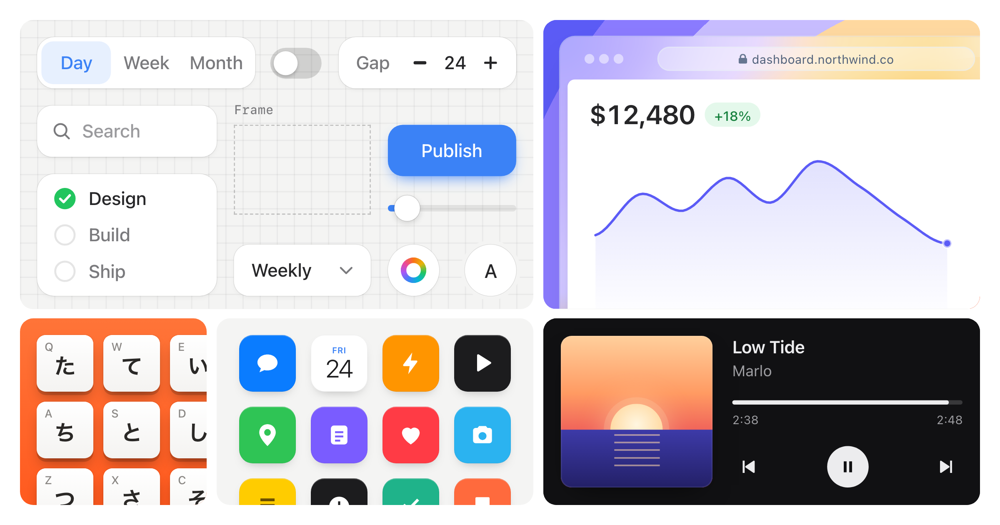

# Skills

디자인과 모션 작업을 위해 코딩 에이전트와 함께 사용하는 스킬입니다.

## Stageshow



에이전트가 실제 제품처럼 보이는 가짜 제품 UI를 만들 수 있도록 도와줍니다: 정적 이미지,
기능 카드, 커서 데모, 벤토 그리드를 React로 구현합니다. 구성과 모션에 대한 가이드,
복사할 수 있는 키트, 예시, 그리고 에이전트가 작업을 확인할 수 있도록 결과를 촬영하는 도구가 포함되어 있습니다.

```sh
npx skills add benjitaylor/skills --skill stageshow
```

[작동 방식](https://benji.org/stageshow) · [스킬 읽기](stageshow/SKILL.md) · [예시 미리보기](stageshow/README.md#preview)

각 스킬에는 자체 라이선스와 서드파티 에셋 고지사항이 포함되어 있습니다.
