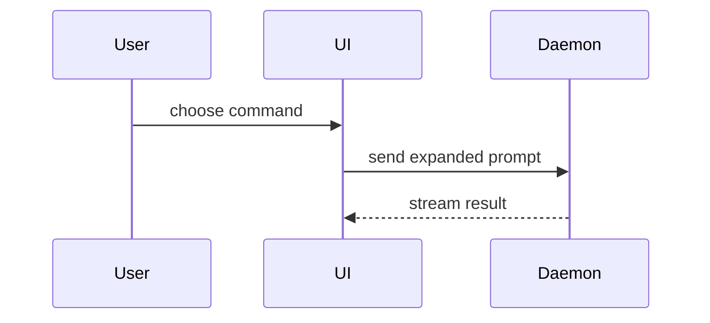

PR 본문 작성을 위해 이 템플릿을 사용하세요:

```markdown
## Summary

<diagram, diff-sketch, or tree>

## Evidence

- **Before:** <screenshot/output/failing test run>
  **After:** <screenshot/output/passing test run>

## Merge Danger

**Door:** <one-way or two-way>

<optional: description>

**Blast Radius:** <one-word description>

<optional: potential ramifications of merge>
```

## 섹션

모든 서문을 건너뛰고 산문을 간략하게 유지하세요. `GLOSSARY.md`에서 사용자의 도메인 언어를 사용하세요.

### Summary

핵심 포인트를 명확하게 만드는 가장 작은 뷰를 선택하세요.

- 로직이나 알고리즘을 수도 코드로 보여주세요:

```text
on(save)
  if content is unchanged
    return cached result
  write new content
  return fresh result
```

- 런타임 제어 흐름을 호출 트리로 보여주세요:

```text
submitForm
  createSession
    persistPrompt
    launchAgent
  navigateToSession
```

- UI 구조를 컴포넌트 트리로 보여주세요. 중요한 상태와 모듈 경계를 포함:

```text
<SessionPage> (apps/example/src/routes/session.tsx)
  useSessionEvents()
  <SessionToolbar>
    <RunSkillButton> (packages/ui)
```

- 파일 책임이나 광범위한 리팩토를 얕은 파일 트리로 보여주세요:

```text
src/
├── commands/       # parses user actions
├── sessions/       # owns session state
└── transport/      # sends API requests
```

- Mermaid로 컴포넌트 상호작용, 제어 흐름 또는 데이터 흐름을 보여주세요:



- 포인트가 무엇이 변경되는지이고 주변 형태가 이미 존재할 때 `diff`를 사용하세요. diff 형태를 주제에 맞추세요.

컴포넌트 변경의 경우:

```diff
 <SessionPage>
   useSessionEvents()
   <SessionToolbar>
+    <RunSkillButton />
   <SessionTimeline>
+    <SkillResultCard />
```

파일 레이아웃 변경의 경우:

```diff
 src/
 ├── commands/
+│   └── show-me.ts       # expands the slash command
 ├── sessions/
-└── transport.ts
+└── transport/
+    ├── client.ts
+    └── stream.ts
```

호출 트리 또는 호출 스택 변경의 경우:

```diff
 submitForm
   createSession
     persistPrompt
+    expandSkillMention
     launchAgent
-  navigateToSession
+  navigateToSession
+    subscribeToEvents
```

상태 또는 제어 흐름 변경의 경우:

```diff
 on(save)
-  write content
+  if content is unchanged
+    return cached result
+  write new content
+  invalidate cache
```

- 대부분이 새로울 때, 생략된 컨텍스트가 소유권이나 순서를 숨길 때, 또는 사용자가 복사 가능한 대상 형태가 필요할 때 전체 블록을 보여주세요:

```ts
function expandSkill(command: string): string {
  const skillName = command.slice(1);
  return `use the ${skillName} skill`;
}
```

#### 가이던스

각 시각을 그것이 지원하는 짧은 텍스트 옆에 배치하세요. 사용자의 현재 질문에 답하거나 현재 토론 포인트를 해결하기 위한 옵션에 필요한 호출, 파일, props, 상태, 경계만 유지하세요.

여러분은 이들 중 하나를 사용할 수 있고, 여러 개를 사용할 수 있으며, 모두 사용할 가능성은 낮습니다. 판단을 사용하고 사용자를 압도하지 마세요.

### Evidence

변경이 작동한다는 구체적인 증거. 전후를 보여주세요.

스크린샷은 S-tier입니다 - 환경이 설정되어 있고 변경이 시각적일 때.

실행 기반 증거는 A-tier입니다. 테스트 결과, 콘솔 출력. 이제 실패하고 통과하는 정확한 테스트를 보여주세요. 수도 코드 사용.

### Merge Danger

일방향 또는 양방향 도어인지 설명하세요. 양방향 도어를 통해 되돌아갈 수 있지만, 일방향 도어는 그렇지 않습니다. 롤백하기 저렴한 PR은 더 낮은 위험입니다. 파괴적 행동이나 되돌리기 어려운 결정을 포함하는 변경은 일방향 도어입니다.

폭발 반경은 이 PR이 도입한 변경의 잠재적 영향 또는 범위입니다. 모든 가능성을 고려하세요. 예제는 레이아웃 시프트, 소비자를 위한 깨짐, 모바일 반응성 등입니다.
